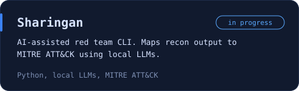
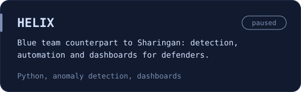
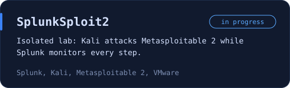
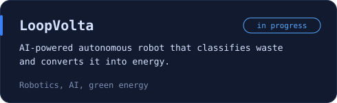

<div align="center">






</div>


```yaml
name: yasseene
role: computer engineering student, 4th year
school: TEK-UP University
location: tunisia
focus:
  - offensive security
  - defensive security
  - AI engineering (local LLMs)
daily-driver: fedora
principles:
  - build real things
  - document decisions
  - test before trusting
status: seeking a summer 2027 internship
```


<a href="https://github.com/mUchiha26/Sharingan"></a>
<a href="https://github.com/mUchiha26/HELIX-PoC"></a>



Sharingan (red team) and HELIX (blue team) are two halves of one idea: build the attack tooling and the defense tooling side by side, so each one sharpens the other.


[](https://skillicons.dev)


**Earned**

-3b82f6?style=flat-square&labelColor=0b1020)


**In progress**


[](https://git.io/streak-stats)


[](https://www.linkedin.com/in/rahal-med-yassine-571827243)
[](https://github.com/mUchiha26)
